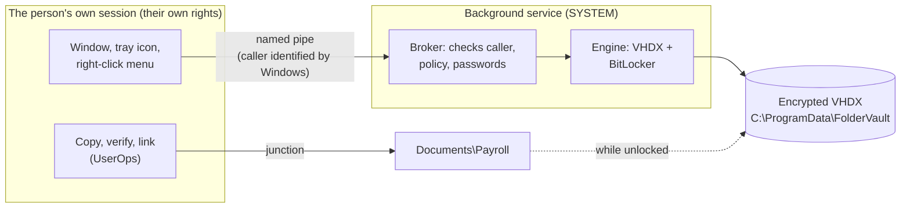

# Folder Vault

**Password-protected folders for Windows, built only from what Windows
already has.**

A protected folder stays where it is, with the same name, but looks empty
until someone unlocks it with that folder's own password, which is separate
from the Windows password. The files inside are encrypted by BitLocker.
Folders lock by themselves when the screen locks.

It was written for a small office where several people knew each other's
Windows passwords, so signing in as a colleague was enough to read their
files. Folder Vault makes a second password necessary for the folders that
matter.

> **Status: prototype (0.4.4).** 479 automated tests pass, and the installer,
> background service, health check and folder rules have run on a real
> Windows 11 PC. The first attempt to protect a folder there failed safely
> and led to the fixes in 0.4.1 to 0.4.4; protecting, unlocking and locking have **not
> yet completed on Windows**. Do not use it for real data until the Windows test
> programme has passed on a test computer (see
> [Testing](#testing) and [docs/SPECIFICATION.md](docs/SPECIFICATION.md#8-acceptance)).

## What it does

- **Protect any folder of your own** from the right-click menu: in Documents,
  Desktop or OneDrive, or on another drive such as `D:\Accounts`.
- **One password per folder**, chosen by the person, and shareable with
  colleagues for folders in a shared area set up by IT.
- **Locks by itself** on screen lock, sign-out, restart, and after four hours.
- **Encrypted at rest**: each folder's files live in a BitLocker-encrypted
  (XTS-AES-256) virtual disk. Copying it to a USB stick gives a snooper nothing.
- **Recoverable by IT only**: a forgotten password is reset with a recovery
  key encrypted to a certificate whose private key never touches the PC.
- **Safe with data**: every file is checked (SHA-256) before an original is
  deleted; any failure leaves the original in place.
- **Light**: the background service sleeps while everything is locked
  (measured at 96 to 99 MB and 0.00 % CPU when idle).
- **Easy to install and remove**: double-click `Install.cmd`,
  `Check-ThisPC.cmd` or `Uninstall.cmd`. No extra software, no internet.

## How it works



The service does only the privileged work (create, unlock, lock and delete
encrypted containers) and never opens a folder a person names. Everything
that touches the person's files runs in their own session with their own
rights, which removes a whole class of privilege-escalation attacks. Details:
[docs/ARCHITECTURE.md](docs/ARCHITECTURE.md).

## Documentation

| You are... | Read |
|---|---|
| Someone who will use it | [docs/USER-GUIDE.md](docs/USER-GUIDE.md) |
| Installing it | [docs/SETUP-GUIDE.md](docs/SETUP-GUIDE.md) |
| Deciding whether to use it | [docs/FOR-MANAGERS.md](docs/FOR-MANAGERS.md) |
| Not sure what a word means | [docs/GLOSSARY.md](docs/GLOSSARY.md) |
| Reviewing the design | [docs/SPECIFICATION.md](docs/SPECIFICATION.md) (requirements and how each is tested), [docs/ARCHITECTURE.md](docs/ARCHITECTURE.md), [docs/SECURITY-AUDIT.md](docs/SECURITY-AUDIT.md), [docs/PURPLE-TEAM-PLAN.md](docs/PURPLE-TEAM-PLAN.md) |
| Curious how it was built | [docs/PROJECT-RECORD.md](docs/PROJECT-RECORD.md) (the whole story, versions 0.1 to 0.4), [CHANGELOG.md](CHANGELOG.md), [docs/PUBLICATION-AUDIT.md](docs/PUBLICATION-AUDIT.md) |
| Publishing your own copy | [docs/PUBLISHING.md](docs/PUBLISHING.md) |

## Requirements

- Windows 10 or 11 **Pro**, Enterprise or Education (BitLocker is needed;
  Windows Home cannot run it)
- Windows PowerShell 5.1 (part of Windows)
- BitLocker switched on for drive C: (strongly recommended)
- Staff using standard accounts, not administrator accounts

## Getting it running

Folder Vault is installed from a release zip, not from the repository
folder directly, because the installer checks every file against the
release's fingerprints (`SHA256SUMS.txt`).

```powershell
# 1. Build the release zips (any computer with PowerShell 7)
pwsh -File build/Build-Package.ps1
#    -> dist/FolderVault-0.4.4-client.zip  (what a PC needs)
#    -> dist/FolderVault-0.4.4.zip         (everything)

# 2. Make a recovery key pair, once, on an IT admin machine (Windows)
.\admin\New-FVEscrowCertificate.ps1 -ClientName Office -OutputDirectory C:\FVKeys
#    -> FolderVault-Escrow-Office.cer  goes next to Install.cmd
#    -> FolderVault-Escrow-Office.pfx  stays offline, never on a client PC
```

3. On a **test** PC, unzip the client kit into a folder only administrators
   can change (see [SETUP-GUIDE Part 2a](docs/SETUP-GUIDE.md)), add the
   `.cer` file, and double-click `Check-ThisPC.cmd`, then `Install.cmd`.

## Testing

| Layer | How | Where it runs |
|---|---|---|
| Unit tests (479, plus 2 that need Windows or a built package) | `Invoke-Pester ./tests/unit` | Any OS with PowerShell 7.4+ and Pester 6 (runs on every push, see `.github/workflows`) |
| Static rules for Windows PowerShell 5.1 pitfalls | Part of the unit tests (`Static.Tests.ps1`) | Same |
| .NET Framework 4.8 API check | `pwsh -File tests/tools/Get-FVReferenceAssemblies.ps1`, then the unit tests | Same |
| PSScriptAnalyzer (5.1 compatibility profiles) | `Invoke-ScriptAnalyzer -Path src -Recurse -Settings ./PSScriptAnalyzerSettings.psd1` | Same |
| Windows test programme (W01 to W80) | `tests\windows\Invoke-FolderVaultIntegrationTests.ps1`, elevated, on a spare test PC | Windows 10/11 Pro test computer only, about 20 minutes |
| Purple team exercise (P-01 to P-20) | [docs/PURPLE-TEAM-PLAN.md](docs/PURPLE-TEAM-PLAN.md) | Two test VMs, two days |

The Windows test programme creates test accounts, containers and a test
recovery key. **Never run it on a PC that is used for real work.**

## Repository layout

```
Check-ThisPC.cmd, Install.cmd, Uninstall.cmd    double-click entry points
src/       Folder Vault itself (installed to C:\Program Files\FolderVault)
install/   installer, uninstaller, readiness check
admin/     IT tools: recovery certificate, password recovery, health check
tests/     unit/ (Pester), windows/ (test programme), tools/ (checkers)
docs/      guides, specification, architecture, audits
build/     makes the release zip files
```

## Security

Folder Vault is a strong lock on certain folders, not a way to make a PC
secure. It cannot protect against a local administrator, or against a
keylogger planted by someone who knows the person's Windows password.
The full threat model and the accepted risks are in
[docs/ARCHITECTURE.md](docs/ARCHITECTURE.md) and
[docs/FOR-MANAGERS.md](docs/FOR-MANAGERS.md). To report a vulnerability, see
[SECURITY.md](SECURITY.md).

## Licence

MIT. See [LICENSE](LICENSE).
